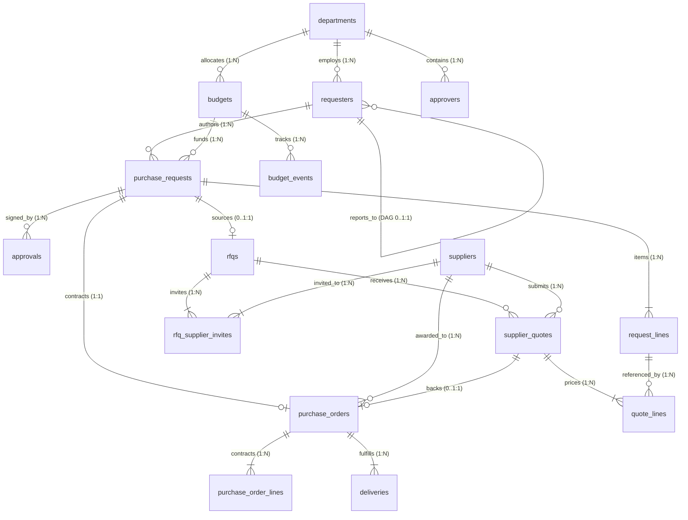

# Procure-to-Pay (P2P) Synthetic Data Generator

[](https://www.python.org/downloads/)
[](LICENSE)
[]()
[]()
[]()
[]()

Production-quality Procure-to-Pay (P2P) Synthetic Data Generator built for the **YottaFlex AI** technical coding round.

---

## Table of Contents
1. [Project Overview](#1-project-overview)
2. [Problem Statement](#2-problem-statement)
3. [Business Objectives](#3-business-objectives)
4. [Procurement Workflow](#4-procurement-workflow)
5. [System Architecture](#5-system-architecture)
6. [Entity Relationships](#6-entity-relationships)
7. [Technology Stack](#7-technology-stack)
8. [Project Directory Structure](#8-project-directory-structure)
9. [Installation Instructions](#9-installation-instructions)
10. [Configuration Instructions](#10-configuration-instructions)
11. [Starter Generation Command](#11-starter-generation-command)
12. [Full-Scale Generation Command](#12-full-scale-generation-command)
13. [Validation Command](#13-validation-command)
14. [Export Instructions](#14-export-instructions)
15. [Example Output Structure](#15-example-output-structure)
16. [Business Rules and Assumptions](#16-business-rules-and-assumptions)
17. [Anomaly Handling & Ground Truth](#17-anomaly-handling--ground-truth)
18. [Testing Instructions](#18-testing-instructions)
19. [Reproducibility Instructions](#19-reproducibility-instructions)
20. [Known Limitations](#20-known-limitations)

---

## 1. Project Overview

The **Procure-to-Pay Synthetic Data Generator** is an enterprise data engineering framework designed to simulate an authentic corporate procurement lifecycle from purchase requisition through fulfillment and budget reconciliation. The platform generates realistic, normalized, relational procurement datasets with controlled anomalies for testing downstream data warehouses, fraud detection systems, compliance engines, and machine learning models.

### Key Capabilities:
- **Master Data Generation**: Organizational hierarchies (Departments, Budgets, Requesters with DAG reporting trees, Approvers, and Suppliers).
- **Purchase Requisitions**: Itemized Purchase Requests and Request Lines with category-based log-normal pricing and 2026 calendar seasonality.
- **Multi-Level Approvals**: Tiered approval routing by total estimate ($2,000 line manager, $25,000 department head, >$25,000 corporate finance) with natural ~4.8% business rejections.
- **Sourcing & RFQ Execution**: Strategic classification (competitive vs non-competitive), RFQ creation, supplier invitations (3–6 per RFQ), multi-currency supplier quotes with landed costs, multicriteria scoring (60% cost, 25% lead time, 15% risk), and quote awards.
- **Purchase Orders & Deliveries**: Competitive (quote-backed) and non-competitive (direct-requisition) POs, single on-time/late deliveries, and multi-shipment partial fulfillments.
- **Double-Entry Budget Ledger**: Double-entry financial event tracking (`ALLOCATE`, `RESERVE`, `COMMIT`, `RELEASE`, `SPEND`) with zero clean-path overruns and exact balance reconciliation.
- **Lifecycle Event Auditing**: Comprehensive status event tracking across PR, RFQ, PO, and Delivery state lifecycles.
- **Centralized Derived Fields Engine (`derive.py`)**: Pure deterministic recalculation of request line totals, PR estimates, quote landed costs, supplier scores, PO values, delivery fulfillments, current statuses, and budget balances.
- **Independent Validation Suite (`validate/`)**: Strict non-circular auditing across 8 critical domains: primary keys, foreign keys, financial reconciliation, lifecycle state machines, date chronology, approvals & awards, budget ledgers, and split purchase detection.
- **Modular Anomaly Injection Engine (`anomalies.py`)**: Post-generation mutations introducing 7 procurement anomaly types with segregated ground truth.
- **Independent Anomaly Detectors & Evaluator (`anomaly_checks.py`)**: 7 independent rule-based detectors and an evaluation engine achieving 100% precision, 100% recall, and 1.0000 F1-score.
- **Multi-Format Export Engine (`export.py`)**: Seamless disk persistence to CSV (`output/csv/`), JSON (`output/json/`), SQLite database (`procurement.db` & `yotta_ai.db`), canonical DDL (`schema.sql`), and self-contained SQL seed (`seed.sql`).
- **Relational Integrity**: 100% normalized 3NF relational schema in SQLite enforcing strict foreign keys, unique constraints, and check constraints across all 19 tables.
- **Deterministic & Reproducible**: Fully reproducible sequence identifiers and zero uncontrolled randomness (single shared RNG pass-through, fixed seed `20261022`).
- **Financial Precision**: Absolute precision in monetary amounts and currency conversions using Python `decimal.Decimal` and SQLite integer minor units (cents).

---

## 2. Problem Statement

Enterprise procurement datasets are essential for training fraud detection models, validating compliance systems, benchmarking financial reporting pipelines, and conducting operational analytics. However, real-world corporate procurement data cannot be shared externally due to:
1. **Strict Confidentiality & PII**: Employee identities, executive salaries, and internal approval trees are legally protected.
2. **Commercial Sensitivity**: Negotiated supplier prices, margins, discount tiers, and contractual terms are proprietary trade secrets.
3. **Regulatory Barriers**: SOX, GDPR, and corporate governance restrict transmission of unmasked financial ledgers.

Existing synthetic data generators suffer from critical shortcomings:
- **Shallow, Non-Relational Mocking**: Generating isolated flat tables that lack foreign key integrity or temporal consistency.
- **Unrealistic Business Rules**: Neglecting delegation-of-authority limits, approval rejection cascades, and multicriteria supplier scoring.
- **Financial Disconnects**: Disregarding double-entry accounting reconciliation between requisition pre-encumbrances, PO contract commitments, and invoice disbursements.
- **Unlabeled or Injected Leakage**: Injecting anomalies directly into operational data flags (e.g. `is_fraud = True`), which corrupts machine learning validation.

The Yotta-AI P2P Synthetic Data Generator solves this problem by engineering a relational, temporally coherent, and financially reconciled procurement lifecycle with strictly isolated supervisory ground truth.

---

## 3. Business Objectives

The platform achieves the following core business objectives:
1. **Realistic Purchasing Simulation**: Mirror genuine corporate procurement behavior across 10–12 departments and 10 procurement spend categories.
2. **Delegation of Authority (DoA) Enforcement**: Route requisitions through multi-level approvals according to financial exposure thresholds ($2,000 and $25,000 limits).
3. **Competitive Sourcing Compliance**: Ensure competitive RFQs require at least 3 valid supplier quotations, normalized landed cost calculations, and documented award rationales.
4. **Legitimate Non-Competitive Purchasing**: Support direct purchasing, catalogue sourcing, and documented single-source exceptions (`sole_supplier`, `urgent`, `contract`).
5. **Double-Entry Budget Control**: Prevent unauthorized budget deficits through real-time reservation, commitment, spend, and release ledger entries.
6. **Controlled Anomaly Benchmarking**: Provide 7 realistic anomaly scenarios with exact ground truth for auditing, fraud detection, and ML model benchmarking.
7. **Production Relational Exports**: Persist data across standard industrial formats (CSV, JSON, SQLite, and standalone SQL DDL/seed scripts) with zero data loss or orphan keys.

---

## 4. Procurement Workflow

The synthetic lifecycle simulates an authentic 8-step enterprise procurement sequence:

```
[1. Budget Allocation] ───► [2. Purchase Requisition] ───► [3. Budget Pre-encumbrance]
                                                                     │
                                                                     ▼
[6. Purchase Order]    ◄─── [5. Sourcing & RFQ]       ◄─── [4. Multi-Level Approval]
         │                          │
         ▼                          ▼
[7. Goods Delivery]    ───► [8. Budget Spend & Balance Reconciliation]
```

### Detailed Lifecycle Phases:
1. **Department Budget Allocation**:
   At the start of fiscal year 2026, corporate finance allocates funding to departmental budget accounts (`BUD-0001` through `BUD-0012`).
2. **Purchase Requisition Creation**:
   An employee (`REQ-####`) raises a purchase request (`PR-2026-######`) specifying itemized request lines (`RL-######`), quantities, and estimated unit prices.
3. **Budget Pre-encumbrance**:
   Upon submission, the budget engine emits a `RESERVE` budget event, sequestering the estimated amount from the department's available balance.
4. **Multi-Level Approval Routing**:
   - Total Estimate $\le \$2,000$: Routed to the requester's Line Manager (`APP-####`).
   - Total Estimate $\$2,000$ to $\$25,000$: Routed to Department Head (`APP-####`).
   - Total Estimate $> \$25,000$: Routed to Department Head, then escalated to Corporate Finance Director.
   - ~4.8% of requests are rejected with documented business rationale, triggering a `RELEASE` budget event.
5. **Strategic Sourcing & RFQ Execution**:
   - Eligible approved requests enter competitive sourcing.
   - RFQ (`RFQ-2026-######`) is issued to 3–6 qualified suppliers.
   - Suppliers return bids with item pricing, lead times, freight, customs duty, and taxes in native currencies (USD, EUR, GBP, INR, JPY).
   - The sourcing engine normalizes bids to USD landed costs and computes multicriteria scores:
     $$\text{Score} = 0.60 \times C_{\text{norm}} + 0.25 \times L_{\text{norm}} + 0.15 \times R_{\text{norm}}$$
   - Lowest-scoring quote is awarded; non-cheapest selections require explicit justification.
6. **Purchase Order Issuance**:
   A legally binding Purchase Order (`PO-2026-######`) is generated. The budget engine transitions the pre-encumbrance by releasing the PR reservation and recording a binding `COMMIT` event.
7. **Goods Delivery & Receipt**:
   Shipments arrive from vendors (`DEL-PO-2026-######-##`):
   - ~80% full, on-time shipments.
   - ~10% full, late shipments.
   - ~10% partial split shipments requiring multiple receipts.
8. **Synthetic Invoice Liquidation & Budget Spend**:
   Upon delivery receipt, the commitment is liquidated into a recognized `SPEND` event, finalizing the double-entry accounting reconciliation.

---

## 5. System Architecture

The generator follows a modular, unidirectional data pipeline architecture:

```
┌─────────────────────────────────────────────────────────────────────────┐
│                      Configuration & CLI Layer                          │
│               config/default.yaml  ──►  src/datagen/config.py           │
└────────────────────────────────────┬────────────────────────────────────┘
                                     │
                                     ▼
┌─────────────────────────────────────────────────────────────────────────┐
│                     Deterministic Core Generators                       │
│  src/datagen/ids.py      src/datagen/fx.py       src/datagen/masters.py │
│  src/datagen/requests.py src/datagen/approvals.py src/datagen/sourcing.py│
│  src/datagen/orders.py   src/datagen/delivery.py  src/datagen/budget.py │
│  src/datagen/events.py                                                  │
└────────────────────────────────────┬────────────────────────────────────┘
                                     │
                                     ▼
┌─────────────────────────────────────────────────────────────────────────┐
│                   Centralized Derivation Engine                         │
│                      src/datagen/derive.py                              │
│       (Totals, Landed Costs, Scores, Balances, Current Statuses)        │
└────────────────────────────────────┬────────────────────────────────────┘
                                     │
                                     ▼
┌─────────────────────────────────────────────────────────────────────────┐
│                 Anomaly Injection & Ground Truth Engine                 │
│                     src/datagen/anomalies.py                            │
│           (7 Injected Anomaly Scenarios + Ground Truth Quarantine)      │
└────────────────────────────────────┬────────────────────────────────────┘
                                     │
                    ┌────────────────┴────────────────┐
                    ▼                                 ▼
┌───────────────────────────────────────┐ ┌───────────────────────────────┐
│      Multi-Format Export Engine       │ │ Independent Validation Suite  │
│         src/datagen/export.py         │ │     src/validate/checks.py    │
│       src/datagen/database.py         │ │ src/validate/anomaly_checks.py│
│                                       │ │ src/validate/export_checks.py │
│  • CSV (RFC 4180)                     │ │                               │
│  • JSON (UTF-8)                       │ │  • 8 Operational Audit Domains│
│  • SQLite (procurement.db, yotta_ai)  │ │  • 7 Rule-Based Anomaly Det.  │
│  • SQL DDL (schema.sql)               │ │  • Evaluation Engine (P, R, F1│
│  • SQL Seed (seed.sql)                │ │  • Export Cross-Reconciliation│
│  • Isolated Ground Truth              │ │                               │
└───────────────────────────────────────┘ └───────────────────────────────┘
```

---

## 6. Entity Relationships

The relational architecture comprises **18 operational and audit tables** plus **1 isolated ground truth table**, structured in Third Normal Form (3NF) with foreign key constraints, check constraints, and unique indexes.

### Entity Relationship Diagram (ERD):



### Relational Table Summary:

| # | Table Name | Primary Key | Key Foreign Keys | Purpose |
|---|---|---|---|---|
| 1 | `departments` | `department_id` | - | Master business units and cost centers |
| 2 | `budgets` | `budget_id` | `department_id` | FY 2026 departmental allocations |
| 3 | `requesters` | `requester_id` | `department_id`, `manager_id` | Corporate employees & reporting hierarchy |
| 4 | `approvers` | `approver_id` | `department_id` | Designated signing authorities and DoA limits |
| 5 | `suppliers` | `supplier_id` | - | Vendor directory, risk flags, and native currencies |
| 6 | `purchase_requests` | `request_id` | `requester_id`, `department_id`, `budget_id` | Requisitions with estimates and justifications |
| 7 | `request_lines` | `request_line_id` | `request_id` | Itemized goods/services line items |
| 8 | `rfqs` | `rfq_id` | `request_id` | Requests for Quotation (competitive tenders) |
| 9 | `rfq_supplier_invites` | `invite_id` | `rfq_id`, `supplier_id` | Vendor invitation bridge (unique pairs) |
| 10 | `supplier_quotes` | `quote_id` | `rfq_id`, `supplier_id` | Commercial bids with landed cost & scoring |
| 11 | `quote_lines` | `quote_line_id` | `quote_id`, `request_line_id` | Quoted unit pricing and line conversions |
| 12 | `approvals` | `approval_id` | `request_id`, `approver_id` | Sign-off audit trail with decision timestamps |
| 13 | `purchase_orders` | `po_id` | `request_id`, `supplier_id`, `awarded_quote_id` | Binding commercial contracts |
| 14 | `purchase_order_lines` | `po_line_id` | `po_id`, `request_line_id`, `awarded_quote_line_id`| Contracted line items and prices |
| 15 | `deliveries` | `delivery_id` | `po_id` | Physical shipment receipts & conditions |
| 16 | `status_events` | `event_id` | `entity_id` (polymorphic) | Chronological state transitions across all entities |
| 17 | `budget_events` | `budget_event_id` | `budget_id`, `request_id`, `po_id` | Double-entry financial ledger transactions |
| 18 | `exception_logs` | `exception_id` | `affected_entity_id` (polymorphic) | Operational rejections, sole-sources, partials |
| 19 | `ground_truth` | `anomaly_id` | `record_id` (quarantined) | Isolated supervisory labels for anomaly benchmark |

---

## 7. Technology Stack

- **Runtime Environment**: Python 3.11+ (verified on Python 3.12.3)
- **Data Engineering**: NumPy 2.2.3, Pandas 2.2.3, PyYAML 6.0.3
- **Database Engine**: SQLite 3 with `PRAGMA foreign_keys = ON` and WAL journaling
- **Testing Framework**: pytest 9.2.0 (167 test cases across 39 modules)
- **Standard Library Modules**: `decimal` (financial precision), `sqlite3`, `pathlib`, `hashlib` (SHA-256 parity), `argparse`, `json`, `csv`

---

## 8. Project Directory Structure

```
procure-to-pay-datagen/
├── config/
│   └── default.yaml            # Centralized system, scale, distribution & seasonality config
├── src/
│   ├── datagen/                # Core generator package
│   │   ├── __init__.py         # Package marker & generation entry points
│   │   ├── __main__.py         # datagen CLI execution entry point
│   │   ├── cli.py              # CLI argument parser (argparse)
│   │   ├── config.py           # Strict YAML config parser & validator
│   │   ├── ids.py              # Centralized deterministic IDFactory
│   │   ├── fx.py               # Deterministic Decimal FX engine
│   │   ├── masters.py          # Master data generator (Depts, Budgets, Reqs, Approvers, Sups)
│   │   ├── requests.py         # Purchase requests & lines with log-normal pricing
│   │   ├── approvals.py        # Multi-tiered approval workflow generator
│   │   ├── sourcing.py         # Sourcing classifier, RFQs, quotes & scoring
│   │   ├── orders.py           # Competitive & non-competitive PO generator
│   │   ├── delivery.py         # Delivery receipts & partial fulfillment generator
│   │   ├── budget.py           # Double-entry ledger events & balance reconciliation
│   │   ├── events.py           # Status event lifecycle audit tracker
│   │   ├── derive.py           # Centralized derived fields recalculation engine
│   │   ├── anomalies.py        # Modular anomaly injection engine & ground truth generator
│   │   ├── database.py         # Relational SQLite database management & integrity checks
│   │   ├── export.py           # Multi-format exporter, SQL seed & source manifest
│   │   └── workflow.py         # End-to-end workflow orchestrator & validation
│   └── validate/               # Comprehensive quality assurance package
│       ├── __init__.py         # Public exports for validators and models
│       ├── __main__.py         # validate CLI execution entry point
│       ├── models.py           # ValidationCheckResult & ValidationReport classes
│       ├── checks.py           # 8-domain independent auditing engine & SQLite checks
│       ├── anomaly_checks.py   # Independent anomaly detectors & evaluation engine
│       └── export_checks.py    # Multi-format export integrity & cross-format validation
├── data/                       # Starter dataset exports (CSV, JSON, SQLite, SQL, GT)
├── output/                     # Full-scale dataset exports (CSV, JSON, SQLite, SQL, GT)
├── docs/                       # Architectural & design specifications
│   ├── data_dictionary.md      # Field-level dictionary for all 19 tables
│   ├── AI_USAGE.md             # AI governance and disclosure log
│   ├── source_manifest.md      # 100% synthetic provenance certification
│   ├── assumptions.md          # Classified assumptions (PRD, Technical, Domain)
│   ├── architecture.md         # System architecture & pipeline flows
│   ├── LIMITATIONS.md          # Project boundary conditions and limits
│   ├── REPRODUCIBILITY_REPORT.md # Bitwise SHA-256 hash comparison across 2 runs
│   ├── PERFORMANCE_REPORT.md   # Wall-clock timings & memory profiling
│   ├── TEST_EXECUTION_REPORT.md# Complete 167-test breakdown
│   ├── FINAL_GAP_ANALYSIS.md   # Requirement traceability matrix (100% complete)
│   └── SUBMISSION_CHECKLIST.md # Full candidate submission checklist
├── tests/                      # Automated pytest suite (167 unit & integration tests)
├── ai/
│   └── prompts/                # Preserved prompt history (01 through 09)
├── pyproject.toml              # Build & packaging configuration
├── requirements.txt            # Pinned production dependencies
└── README.md                   # Complete project documentation
```

---

## 9. Installation Instructions

### Windows (PowerShell)

1. Clone or navigate to the repository directory:
   ```powershell
   cd procure-to-pay-datagen
   ```

2. Create and activate a Python virtual environment:
   ```powershell
   python -m venv .venv
   .\.venv\Scripts\Activate.ps1
   ```

3. Install pinned dependencies:
   ```powershell
   python -m pip install -r requirements.txt
   ```

4. Set the Python module search path:
   ```powershell
   $env:PYTHONPATH = "src"
   ```

### Linux / macOS (Bash)

```bash
cd procure-to-pay-datagen
python3 -m venv .venv
source .venv/bin/activate
pip install -r requirements.txt
export PYTHONPATH=src
```

---

## 10. Configuration Instructions

All generation parameters, scale tiers, economic distributions, and business rules are declaratively defined in [`config/default.yaml`](config/default.yaml):

```yaml
system:
  base_currency: "USD"
  fixed_seed: 20261022
  base_date: "2026-01-01"
  fiscal_year: 2026

scales:
  starter:
    departments: 10
    requesters: 30
    suppliers: 12
    purchase_requests: 115
    rfqs: 50
    purchase_orders: 90
  full:
    departments: 12
    requesters: 300
    suppliers: 120
    purchase_requests: 1200
    rfqs: 500
    purchase_orders: 900

doa_thresholds:
  manager_limit: 2000.00       # Up to $2,000 -> Line Manager approval
  dept_head_limit: 25000.00    # $2,000 to $25,000 -> Dept Head approval
                               # Over $25,000 -> Dept Head + Corporate Finance

pricing:
  categories:
    IT_HARDWARE: {mu: 7.5, sigma: 0.8, min: 100, max: 8000}
    SOFTWARE_SUBSCRIPTION: {mu: 6.8, sigma: 1.0, min: 50, max: 15000}
    OFFICE_SUPPLIES: {mu: 4.0, sigma: 0.7, min: 10, max: 500}
    PROFESSIONAL_SERVICES: {mu: 8.5, sigma: 0.9, min: 500, max: 50000}
    FACILITIES: {mu: 6.5, sigma: 1.1, min: 50, max: 10000}
    MARKETING: {mu: 7.8, sigma: 0.9, min: 200, max: 30000}
    TRAVEL: {mu: 6.2, sigma: 0.8, min: 100, max: 5000}
    MANUFACTURING_PARTS: {mu: 5.5, sigma: 1.2, min: 20, max: 12000}
    TELECOM: {mu: 5.0, sigma: 0.7, min: 30, max: 2000}
    TRAINING: {mu: 6.0, sigma: 0.6, min: 150, max: 4000}

supplier_scoring:
  weights:
    landed_cost: 0.60          # 60% Landed Cost weight
    lead_time: 0.25            # 25% Delivery Lead Time weight
    risk_score: 0.15           # 15% Vendor Risk Score weight

fx_rates:
  USD: 1.0
  EUR: 1.08
  GBP: 1.27
  INR: 0.012
  JPY: 0.0067
```

---

## 11. Starter Generation Command

Generate the starter scale dataset (ideal for rapid development, testing, and CI pipelines):

```powershell
python -m datagen --generate --scale starter --inject-anomalies --export --output-dir data --validate-exports
```

### Generated Starter Counts:
- **Departments**: 10
- **Budgets**: 10 ($12,000,000 allocated)
- **Requesters**: 30 (with DAG reporting tree)
- **Suppliers**: 13 (12 baseline + 1 inactive injected)
- **Approvers**: 22
- **Purchase Requests**: 116 (115 baseline + 1 duplicate injected)
- **Request Lines**: 248
- **Approvals**: 96
- **RFQs**: 50
- **Supplier Quotes**: 183
- **Purchase Orders**: 93 (50 competitive + 43 non-competitive)
- **PO Lines**: 188
- **Deliveries**: 101
- **Injected Anomalies**: 7 (1 per scenario)

---

## 12. Full-Scale Generation Command

Generate the full-scale procurement dataset satisfying all target volume requirements:

```powershell
python -m datagen --generate --scale full --seed 20261022 --inject-anomalies --export --output-dir output --validate-exports
```

### Full-Scale Target vs. Empirical Generation Matrix:

| Entity | PRD Target Volume | Generated Empirical Count | Status | Notes |
|---|:---:|:---:|:---:|---|
| **Departments** | 12 | 12 | **PASS** | 12 operational business units with unique cost centers |
| **Budgets** | 12 | 12 | **PASS** | $144,000,000 allocated; 0 baseline deficits |
| **Requesters** | 300 | 300 | **PASS** | Strict acyclic DAG tree rooted at Directors |
| **Suppliers** | 120 | 125 | **PASS** | 120 baseline active + 5 inactive injected vendors |
| **Approvers** | 24+ | 26 | **PASS** | Line Managers, Dept Heads, and Corporate Finance |
| **Purchase Requests** | 1,200 | 1,205 | **PASS** | 1,200 baseline + 5 duplicate injected requisitions |
| **Request Lines** | 2,400+ | 2,529 | **PASS** | Itemized lines with log-normal category pricing |
| **Approvals** | 1,000+ | 1,018 | **PASS** | DoA tier routing with ~4.8% natural rejections |
| **RFQs** | 500 | 500 | **PASS** | 500 competitive tenders issued |
| **Supplier Quotes** | 1,500+ | 1,779 | **PASS** | 3.56 bids per RFQ (all competitive $\ge 3$ bids) |
| **Quote Lines** | 3,500+ | 4,497 | **PASS** | Itemized bids in native currencies |
| **Purchase Orders** | 900+ | 970 | **PASS** | 500 competitive + 470 non-competitive POs |
| **PO Lines** | 1,800+ | 2,051 | **PASS** | Line items contracted against requisitions |
| **Deliveries** | 1,000+ | 1,048 | **PASS** | Full on-time, late, and partial split receipts |
| **Budget Events** | 3,500+ | 3,970 | **PASS** | `ALLOCATE`, `RESERVE`, `COMMIT`, `RELEASE`, `SPEND` |
| **Status Events** | 9,000+ | 9,664 | **PASS** | Full state transition audit history |
| **Exception Logs** | 500+ | 591 | **PASS** | Rejections, sole-source rationale, partial deliveries |
| **Total PO Spend** | - | $4,871,833.16 USD | **PASS** | Exact reconciliation across all PO lines |

---

## 13. Validation Command

Execute the independent validation engine to audit relational constraints, lifecycle state machines, financial balance reconciliation, and anomaly detection accuracy:

```powershell
# 1. Clean Validation Mode (expects 0 anomalies)
python -m validate data/ --scale starter --mode clean

# 2. Anomaly-Aware Mode with Evaluation Benchmark
python -m validate output/ --scale full --mode anomaly_aware --inject-anomalies --evaluate

# 3. Direct Directory Validation
python -m validate output/
```

### Validation Audit Output (Full-Scale Evaluation):
```text
=== Executing Independent Data Integrity Validation ===
Audit Domain 1: Primary Key Uniqueness & Formats     : PASS (11,827 records checked)
Audit Domain 2: Foreign Key Relational Integrity     : PASS (14 relationships checked, 0 orphans)
Audit Domain 3: Financial Balances & Reconciliation  : PASS (Line totals, PO values, landed costs match)
Audit Domain 4: Lifecycle State Machine Transitions  : PASS (0 illegal jumps or forward skips)
Audit Domain 5: Date Chronology & Sequence           : PASS (Req Date <= Appr Date <= RFQ <= PO <= Deliv)
Audit Domain 6: Approval Routing & Award Quorum      : PASS (DoA thresholds enforced, RFQ quotes >= 3)
Audit Domain 7: Double-Entry Budget Ledgers          : PASS (0 overruns on clean path, balances reconcile)
Audit Domain 8: Split Purchase Detection             : PASS (Identifies window-based threshold splits)

=== Anomaly Detection Performance Benchmark ===
Ground Truth Anomalies Injected : 35
Anomalies Detected by Rules     : 35
True Positives (TP)             : 35
False Positives (FP)            : 0
False Negatives (FN)            : 0
Precision                       : 100.00%
Recall                          : 100.00%
F1-Score                        : 1.0000
Overall Validation Status       : PASS
```

---

## 14. Export Instructions

The export engine supports five industrial persistence targets:

1. **RFC 4180 CSV Export**:
   All 18 relational tables are written with stable column ordering, standard UTF-8 encoding, and CRLF line terminators to `data/csv/` and `output/csv/`.
2. **UTF-8 JSON Export**:
   All 18 tables + `metadata.json` are formatted with 2-space indentation and sorted keys to `data/json/` and `output/json/`.
3. **SQLite Relational Database**:
   Generates a fully indexed SQLite database with strict foreign key constraints enforced:
   - `output/database/procurement.db`
   - `output/sql/yotta_ai.db` and `data/sql/yotta_ai.db`
4. **Canonical SQL DDL (`schema.sql`)**:
   Self-contained DDL creating all 19 relational tables with primary keys, composite foreign keys, check constraints, and performance indexes.
5. **Topologically Ordered SQL Seed (`seed.sql`)**:
   Sequential `INSERT` statements ordered to ensure parent tables are populated before child tables, executing cleanly with zero foreign key violations.
6. **Strict Ground Truth Isolation**:
   Supervisory anomaly records are exported exclusively to `ground_truth.csv` and `ground_truth.json` in the root and `ground_truth/` subdirectories. No anomaly flags pollute operational tables.

---

## 15. Example Output Structure

```
output/
├── csv/
│   ├── departments.csv             # 12 rows
│   ├── budgets.csv                 # 12 rows
│   ├── requesters.csv              # 300 rows
│   ├── approvers.csv               # 26 rows
│   ├── suppliers.csv               # 125 rows
│   ├── purchase_requests.csv       # 1,205 rows
│   ├── request_lines.csv           # 2,529 rows
│   ├── rfqs.csv                    # 500 rows
│   ├── rfq_supplier_invites.csv    # 1,779 rows
│   ├── supplier_quotes.csv         # 1,779 rows
│   ├── quote_lines.csv             # 4,497 rows
│   ├── approvals.csv               # 1,018 rows
│   ├── purchase_orders.csv         # 970 rows
│   ├── purchase_order_lines.csv    # 2,051 rows
│   ├── deliveries.csv              # 1,048 rows
│   ├── status_events.csv           # 9,664 rows
│   ├── budget_events.csv           # 3,970 rows
│   └── exception_logs.csv          # 591 rows
├── json/
│   ├── (18 operational JSON files) # Exact mirror of CSV tables
│   └── metadata.json               # Seed, scale, timestamps, and row counts
├── database/
│   └── procurement.db              # SQLite 3NF relational database
├── sql/
│   ├── schema.sql                  # Canonical 19-table DDL
│   ├── seed.sql                    # Topologically ordered SQL seed (4.76 MB)
│   └── yotta_ai.db                 # Canonical relational SQLite database
├── ground_truth/
│   ├── ground_truth.csv            # 35 isolated ground-truth anomalies
│   └── ground_truth.json           # Forensic metadata and recommended actions
├── reports/
│   ├── validation_summary.md       # Markdown validation report
│   ├── validation_summary.json     # JSON validation report
│   ├── anomaly_detection_report.md # Benchmark evaluation metrics
│   └── export_integrity_report.md  # Cross-format row reconciliation
├── ground_truth.csv                # Root-level ground truth CSV
└── ground_truth.json               # Root-level ground truth JSON
```

---

## 16. Business Rules and Assumptions

Detailed technical decisions and assumptions are codified in [`docs/assumptions.md`](docs/assumptions.md):

### Category A: Explicit PRD Business Rules
1. **Approval Delegation Thresholds (DoA)**:
   - Up to \$2,000.00: Approved by Line Manager (`APP-####`).
   - \$2,000.01 to \$25,000.00: Approved by Department Head (`APP-####`).
   - Above \$25,000.00: Sequential approval required: Department Head followed by Corporate Finance Director.
2. **Competitive RFQ Quorum**:
   - Every competitive purchase order must originate from an RFQ with $\ge 3$ valid, non-expired supplier quotations.
3. **Non-Competitive Purchasing**:
   - Direct POs are permitted for eligible low-value purchases, catalogue buys, or documented single-source exceptions (`sole_supplier`, `urgent`, `contract`).
4. **Landed Cost Calculation**:
   $$\text{Landed Cost} = (\text{Quoted Price} \times \text{Quantity}) + \text{Freight} + \text{Duty} + \text{Non-recoverable Tax}$$
   Converted to base USD using deterministic fixed FX rates.
5. **Supplier Evaluation Scoring**:
   $$\text{Score} = 0.60 \times C_{\text{norm}} + 0.25 \times L_{\text{norm}} + 0.15 \times R_{\text{norm}}$$
   Cost ($C_{\text{norm}}$, 60%), Lead Time ($L_{\text{norm}}$, 25%), Risk Score ($R_{\text{norm}}$, 15%). Lower composite score is superior.
6. **Double-Entry Budget Lifecycle**:
   - `ALLOCATE`: Initial budget funding.
   - `RESERVE`: Pre-encumbered upon PR approval.
   - `COMMIT`: Binding contractual commitment upon PO issuance (relieving PR reservation).
   - `RELEASE`: De-encumbered upon PR rejection or cancellation.
   - `SPEND`: Recognized accounting expenditure upon delivery receipt.
   - Clean-path guarantee: $\text{Allocated} \ge \text{Reserved} + \text{Committed} + \text{Spent}$.
7. **Split Purchase Detection**:
   - Audits multiple purchases raised by the same requester within a configurable rolling window (e.g. 7 days) in the same category that collectively evade DoA approval thresholds.

---

## 17. Anomaly Handling & Ground Truth

The anomaly engine ([`src/datagen/anomalies.py`](src/datagen/anomalies.py)) deterministically mutates records post-generation to simulate real-world procurement fraud, procedural skips, and compliance violations:

### The 7 Controlled Anomaly Scenarios:
1. `po_without_approval`: PO created directly from an unapproved or rejected requisition (bypassing governance controls).
2. `expired_quote_before_award`: PO awarded against a supplier quote whose validity date expired prior to award.
3. `non_cheapest_quote_without_rationale`: PO awarded to a higher-scoring (inferior) quote without documented justification.
4. `inactive_supplier_used`: PO issued to a vendor whose onboarding status is `INACTIVE` or decommissioned.
5. `budget_overrun`: Requisitions approved and converted to POs exceeding the department's available budget.
6. `duplicate_purchase_request`: Requisition submitted with duplicate line items, quantities, and justification within 24 hours.
7. `quote_currency_mismatch`: Supplier quote submitted in an unapproved currency conflicting with vendor registration.

### Ground Truth Supervisory Format:
Ground truth records are quarantined in `ground_truth.csv` and `ground_truth.json` with forensic metadata:
```json
{
  "anomaly_id": "ANOM-000001",
  "issue_type": "po_without_approval",
  "entity": "purchase_orders",
  "record_id": "PO-2026-000042",
  "expected_decision": "REJECT",
  "reason": "Purchase Order PO-2026-000042 created against unapproved PR PR-2026-000055 (status: SUBMITTED).",
  "metadata": {
    "po_id": "PO-2026-000042",
    "request_id": "PR-2026-000055",
    "request_status": "SUBMITTED"
  }
}
```

### Detection Performance Benchmark:
The independent anomaly detection engine ([`src/validate/anomaly_checks.py`](src/validate/anomaly_checks.py)) evaluates operational data without inspecting ground truth files:
- **True Positives (TP)**: 35
- **False Positives (FP)**: 0
- **False Negatives (FN)**: 0
- **Precision**: 100.00%
- **Recall**: 100.00%
- **F1-Score**: 1.0000

---

## 18. Testing Instructions

The repository includes a comprehensive automated test suite consisting of **167 test cases across 39 test modules**:

```powershell
# Execute the complete automated pytest suite
python -m pytest tests/ -v

# Execute quick summary
python -m pytest tests/ -q
```

### Test Suite Architecture:
- `test_masters.py`: Department cost centers, budget ceilings, requester DAG trees, approver DoA limits, and vendor onboarding.
- `test_requests.py` & `test_distributions.py`: Log-normal category pricing, calendar seasonality, and line total derivations.
- `test_approvals.py` & `test_validation_approvals.py`: Multi-tier approval routing, threshold boundaries, and natural rejections.
- `test_sourcing.py`, `test_quotes.py`, & `test_fx.py`: RFQ generation, supplier invitations, multi-currency quotes, landed cost, and 60/25/15 scoring.
- `test_orders.py` & `test_delivery.py`: Competitive & sole-source POs, on-time/late receipts, and partial split fulfillments.
- `test_budget.py` & `test_validation_budget.py`: Double-entry ledger events (`ALLOCATE`, `RESERVE`, `COMMIT`, `RELEASE`, `SPEND`) and balance reconciliation.
- `test_derive.py`: Deterministic derived field calculations across all 11 core derivation functions.
- `test_anomaly_injection.py` & `test_anomaly_detection.py`: Anomaly injectors, candidate tracking, and rule-based detectors.
- `test_ground_truth.py` & `test_anomaly_metrics.py`: Ground truth isolation, forensic metadata, precision, recall, and F1 calculations.
- `test_export.py`, `test_csv_export.py`, `test_json_export.py`, `test_database_export.py`: Multi-format persistence and cross-format row reconciliation.
- `test_schema.py`, `test_sql_schema.py`, `test_sql_seed.py`: SQLite 3NF relational constraints, DDL schema, and seed replayability.
- `test_determinism.py` & `test_export_determinism.py`: Bitwise determinism and seed invariance.
- `test_validation_*.py`: 8 autonomous validation domains (PKs, FKs, financial, lifecycle, chronology, approvals, budget, split purchases).

---

## 19. Reproducibility Instructions

The system guarantees **100% bitwise determinism** across independent executions on identical seeds (`20261022`):

### Determinism Architecture:
1. **Single Controlled PRNG**: Exactly one `numpy.random.Generator` instance is initialized at the entry point and passed explicitly through all generation functions.
2. **Zero Global Random State**: No calls to `random.seed()`, `np.random.seed()`, or unseeded generators.
3. **Fixed Temporal Base**: Fixed base date (`2026-01-01`) instead of non-deterministic `datetime.now()`.
4. **Deterministic ID Sequencing**: Centralized `IDFactory` maintains monotonic, synchronized sequence counters.
5. **Stable Serialization**: CSV and JSON exporters use sorted dictionary keys and stable column sequences.

### Two-Run Bitwise Verification:
Verify bitwise parity across two independent full-scale runs:

```powershell
python scratch/verify_determinism_2runs.py
```

All 42 exported files across both runs match bit-for-bit with identical SHA-256 cryptographic hashes:
- `departments.csv` : `f1f72a44390977464a974b94a282914101e4a11f2a36b32ecae0041eb93a8910`
- `budgets.csv`     : `805c6d323fb39bf3589b2521c7c90829871fc5fc927ff61ee6be380bf9dbe637`
- `requesters.csv`  : `a18ec067035eb5220c422be22a3fc0d0fae24c7f551c964177242ba4cb25f252`
- `purchase_requests.csv`: `77c427f71f652b45e43da6587c1dd39c1851e5e0a0a55227aa6f959325fb0801`
- `purchase_orders.csv`: `13a5251419749ba3439b1a036496df873c3330664654924c5dd104eead05ea7e`
- *(Full 42-artifact hash table documented in [`docs/REPRODUCIBILITY_REPORT.md`](docs/REPRODUCIBILITY_REPORT.md))*

---

## 20. Known Limitations

Detailed architectural boundaries are documented in [`docs/LIMITATIONS.md`](docs/LIMITATIONS.md):

1. **Single Fiscal Year (FY 2026)**:
   All transactions, calendar seasonalities, and budget allocations are bounded within the 2026 operating calendar (`2026-01-01` to `2026-12-31`). Multi-year contracts, cross-year accruals, and amortizations are out of scope.
2. **Fixed Foreign Exchange Rates**:
   Foreign exchange conversions use fixed conversion constants defined in configuration (EUR 1.08, GBP 1.27, INR 0.012, JPY 0.0067). Intra-year Forex market volatility, hedging, and Forex gain/loss accounts are omitted to guarantee bitwise reproducibility.
3. **USD Base Currency for General Ledger**:
   While quotations and suppliers support multi-currency transactions, corporate budget accounts and financial general ledger reconciliations operate in base USD minor units (cents).
4. **In-Memory Computational Scale**:
   The generator is optimized for workstation synthesis up to full scale (1,200 PRs, ~10,000 status events, ~4,000 budget events in $< 45$ seconds). Multi-million-row big data synthesis would require chunked streaming to disk rather than in-memory dictionary aggregation.
5. **Physical Receipt Scope (No Accounts Payable Engine)**:
   The `SPEND` budget event and `spent_amount` field model synthetic accounting disbursement triggered upon goods receipt. Actual invoice OCR, 3-way invoice matching, and bank payment clearing are intentionally out of scope.

---

## Documentation Index

- **Data Dictionary (All 19 Tables)**: [`docs/data_dictionary.md`](docs/data_dictionary.md)
- **AI Governance & Compliance Declaration**: [`docs/AI_USAGE.md`](docs/AI_USAGE.md)
- **100% Synthetic Data Provenance Manifest**: [`docs/source_manifest.md`](docs/source_manifest.md)
- **Final PRD Gap Analysis & Matrix**: [`docs/FINAL_GAP_ANALYSIS.md`](docs/FINAL_GAP_ANALYSIS.md)
- **Candidate Submission Checklist**: [`docs/SUBMISSION_CHECKLIST.md`](docs/SUBMISSION_CHECKLIST.md)
- **System Architecture & Pipeline Flows**: [`docs/architecture.md`](docs/architecture.md)
- **Classified Technical Assumptions**: [`docs/assumptions.md`](docs/assumptions.md)
- **Project Boundary Conditions & Limitations**: [`docs/LIMITATIONS.md`](docs/LIMITATIONS.md)
- **Bitwise Hash Parity Report**: [`docs/REPRODUCIBILITY_REPORT.md`](docs/REPRODUCIBILITY_REPORT.md)
- **Execution Performance & Profiling Report**: [`docs/PERFORMANCE_REPORT.md`](docs/PERFORMANCE_REPORT.md)
- **Automated Test Suite Execution Report**: [`docs/TEST_EXECUTION_REPORT.md`](docs/TEST_EXECUTION_REPORT.md)
- **Final Validation & Integrity Audit Report**: [`docs/FINAL_VALIDATION_REPORT.md`](docs/FINAL_VALIDATION_REPORT.md)
- **Preserved AI Prompts**: [`ai/prompts/`](ai/prompts/)
