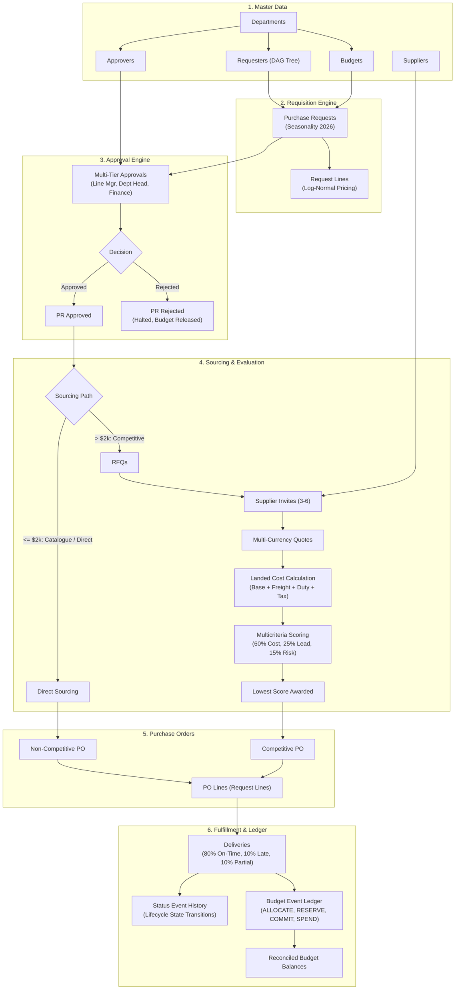

# System Architecture

## 1. Project Purpose & System Boundaries

The **Procure-to-Pay Synthetic Data Generator** (`procure-to-pay-datagen`) is an enterprise-grade synthetic data engineering platform designed to simulate a realistic, end-to-end corporate procurement lifecycle. The platform generates structurally sound, relational, anomaly-injected datasets for testing, machine learning evaluation, and data warehouse benchmarking.

### In Scope (Phases 1, 2, and 3 Complete)
- **Master Data**: Departments, Budgets, Requesters (DAG tree), Suppliers, and Approvers (`src/datagen/masters.py`).
- **Requisitions**: Purchase Requests and Request Lines with log-normal pricing and 2026 calendar seasonality (`src/datagen/requests.py`).
- **Approval Engine**: Multi-level financial thresholds, line manager, department head, and corporate finance approvals (`src/datagen/approvals.py`).
- **Sourcing & Quotations**: Competitive RFQs, supplier invitations, multi-currency quotations, landed costs, and multicriteria scoring (`src/datagen/sourcing.py`).
- **Purchase Orders**: Binding POs and PO lines for competitive and non-competitive sourcing (`src/datagen/orders.py`).
- **Fulfillment & Deliveries**: Physical goods receipts supporting partial and multi-shipment scenarios (`src/datagen/delivery.py`).
- **Budget Ledger**: Double-entry style event ledger (`ALLOCATE`, `RESERVE`, `COMMIT`, `RELEASE`, `SPEND`) with balance reconciliation (`src/datagen/budget.py`).
- **Lifecycle History**: Complete state machine transition tracking across PR, RFQ, PO, and Delivery (`src/datagen/events.py`).
- **End-to-End Orchestration**: Seamless pipeline coordination with clean-path validation (`src/datagen/workflow.py`).

### System Boundaries (Scheduled for Subsequent Phases)
- Phase 4: Foundational automated verification & multi-tier validation package expansion.
- Phase 5: Deep relational anomaly detectors.
- Phase 6: Controlled anomaly injection (split POs, phantom vendors, budget overruns, late shipments).
- Phase 7: Export to CSV, JSON, and bulk SQLite database.

---

## 2. Python Package Structure (src-layout)

```
procure-to-pay-datagen/
├── .gitignore
├── pyproject.toml              # Packaging, build configuration & metadata
├── requirements.txt            # Pinned dependencies
├── README.md                   # Project overview & operator documentation
├── config/
│   └── default.yaml            # Centralized system, scale, distribution & seasonality config
├── src/
│   ├── datagen/                # Core generator package
│   │   ├── __init__.py         # Package exports & entry points
│   │   ├── __main__.py         # datagen execution entry point
│   │   ├── cli.py              # CLI argument parser (argparse)
│   │   ├── config.py           # Strict YAML config parser & validator
│   │   ├── ids.py              # Centralized deterministic IDFactory
│   │   ├── fx.py               # Deterministic Decimal FX engine
│   │   ├── masters.py          # Master data generator (Depts, Budgets, Reqs, Sups, Apps)
│   │   ├── requests.py         # Purchase requests & lines with log-normal pricing
│   │   ├── approvals.py        # Multi-level approval engine
│   │   ├── sourcing.py         # Sourcing, RFQs, quotes, landed costs & scoring
│   │   ├── orders.py           # Purchase orders & PO lines
│   │   ├── delivery.py         # Deliveries & partial shipments
│   │   ├── budget.py           # Budget event ledger & balance reconciliation
│   │   ├── events.py           # Status event lifecycle history
│   │   └── workflow.py         # Workflow orchestration & clean-path validation
│   └── validate/               # Quality assurance & verification package
│       ├── __init__.py
│       ├── __main__.py
│       └── checks.py           # Foundational schema & relational validators
├── data/
│   ├── csv/                    # Target directory for CSV exports (.gitkeep)
│   ├── json/                   # Target directory for JSON exports (.gitkeep)
│   └── sql/
│       ├── schema.sql          # Canonical DDL with strict relational constraints
│       └── seed.sql            # Seed SQL script placeholder
├── docs/                       # Architecture, data dictionary, & technical specifications
│   ├── architecture.md
│   ├── data_dictionary.md
│   ├── assumptions.md
│   ├── validation_summary.md
│   ├── reproducibility.md
│   ├── source_manifest.md
│   └── AI_USAGE.md
├── tests/                      # Automated pytest suite (66 passing tests)
│   ├── __init__.py
│   ├── test_approvals.py       # Approval thresholds & roles
│   ├── test_budget.py          # Budget event ledger & reconciliation
│   ├── test_config.py          # Configuration loading & validation
│   ├── test_delivery.py        # Delivery fulfillment & partial shipments
│   ├── test_determinism.py     # Determinism & seed reproducibility
│   ├── test_distributions.py   # Price & seasonality distribution verification
│   ├── test_fx.py              # Decimal FX conversion
│   ├── test_ids.py             # Centralized IDFactory
│   ├── test_masters.py         # Master data generation
│   ├── test_orders.py          # Purchase order & line reconciliation
│   ├── test_quotes.py          # Quotations, landed cost & scoring
│   ├── test_requests.py        # Purchase requests & request lines
│   ├── test_schema.py          # SQLite schema & constraints
│   ├── test_sourcing.py        # Sourcing classification & RFQ invites
│   ├── test_status_events.py   # State machine transitions
│   └── test_workflow_integration.py # End-to-end integration & determinism
└── ai/
    └── prompts/
        ├── 01_phase1_foundation.md
        ├── 02_phase2_generation.md
        └── 03_phase3_procurement_workflow.md
```

---

## 3. End-to-End Procurement Workflow Pipeline



---

## 4. Determinism & Traceability Guarantees

1. **Single Random Generator**: Exactly one `numpy.random.default_rng(seed)` is initialized at entry and passed down the pipeline.
2. **State-Isolated Sequence Counters**: Identifiers for all 18 entities are produced deterministically through `IDFactory`.
3. **Double-Entry Budget Integrity**: `budget_events` tracks every financial movement, ensuring `allocated >= reserved + committed + spent`.
4. **State Machine Consistency**: Status changes are tracked in `status_events`, guaranteeing chronological validity.
