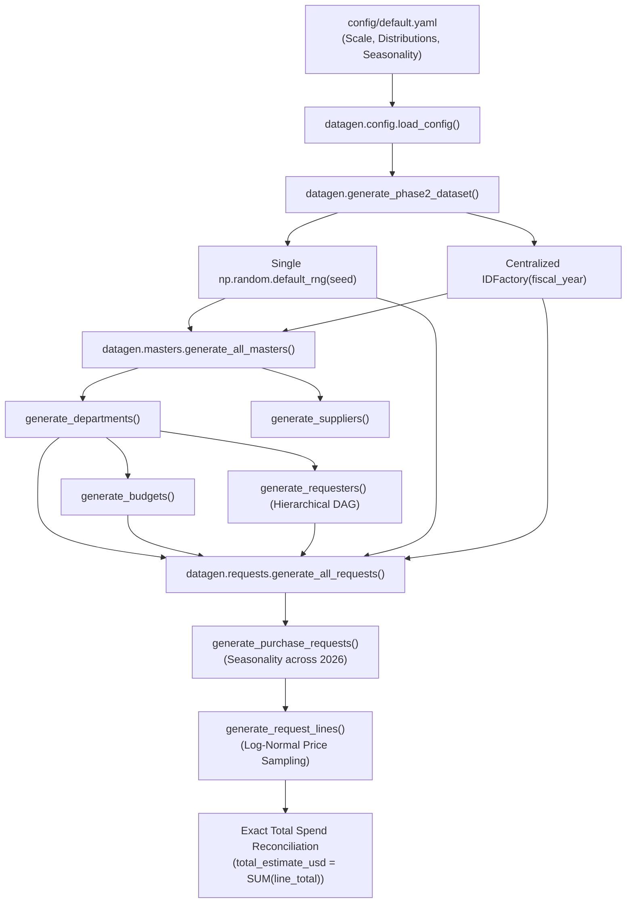

# System Architecture

## 1. Project Purpose & System Boundaries

The **Procure-to-Pay Synthetic Data Generator** (`procure-to-pay-datagen`) is an enterprise-grade synthetic data engineering platform designed to simulate a realistic, end-to-end corporate procurement lifecycle. The platform generates structurally sound, relational, anomaly-injected datasets for testing, machine learning evaluation, and data warehouse benchmarking.

### In Scope (Phase 1 & Phase 2 Complete)
- Generation of master data: Departments, Budgets, Requesters, and Suppliers (`src/datagen/masters.py`).
- Generation of transactional procurement records: Purchase Requests and Request Lines (`src/datagen/requests.py`).
- Category-specific log-normal price modeling with realistic bounds (`category_distributions`).
- Calendar seasonality modeling across fiscal year 2026 (`seasonality`).
- Offline, deterministic foreign exchange (FX) conversion engine (`src/datagen/fx.py`).
- Relational schema modeling in SQLite with complete foreign keys and constraints (`data/sql/schema.sql`).
- Multi-tier validation frameworks and automated pytest suites (`tests/`).

### System Boundaries (Scheduled for Subsequent Phases)
- Phase 3: Sourcing, RFQs, Supplier Invitations, and Multi-Currency Quotations.
- Phase 4: Scoring Engine, Approvals, and Purchase Order creation.
- Phase 5: Deliveries, Goods Receipts, and Budget Ledger Event reconciliation.
- Phase 6: Controlled Anomaly Injection.
- Phase 7: Export to CSV/JSON and Final Verification.

---

## 2. Python Package Structure (src-layout)

```
procure-to-pay-datagen/
├── .gitignore
├── pyproject.toml              # Packaging, build configuration & metadata
├── requirements.txt            # Pinned dependencies
├── README.md                   # Project overview & operator documentation
├── config/
│   └── default.yaml            # Centralized system, scale, distribution & seasonality config
├── src/
│   ├── datagen/                # Core generator package
│   │   ├── __init__.py         # Package entry point & generate_phase2_dataset
│   │   ├── __main__.py         # Module execution entry point
│   │   ├── cli.py              # CLI argument parser (argparse)
│   │   ├── config.py           # Strict YAML config parser & validator
│   │   ├── ids.py              # Centralized deterministic IDFactory
│   │   ├── fx.py               # Deterministic Decimal FX engine
│   │   ├── masters.py          # Master data generator (Depts, Budgets, Reqs, Sups)
│   │   └── requests.py         # Transactional PR & Request Line generator
│   └── validate/               # Quality assurance & verification package
│       ├── __init__.py
│       ├── __main__.py
│       └── checks.py           # Foundational schema & relational validators
├── data/
│   ├── csv/                    # Target directory for CSV exports (.gitkeep)
│   ├── json/                   # Target directory for JSON exports (.gitkeep)
│   └── sql/
│       ├── schema.sql          # Canonical DDL with strict relational constraints
│       └── seed.sql            # Seed SQL script placeholder
├── docs/                       # Architecture, data dictionary, & technical specifications
│   ├── architecture.md
│   ├── data_dictionary.md
│   ├── assumptions.md
│   ├── validation_summary.md
│   ├── reproducibility.md
│   ├── source_manifest.md
│   └── AI_USAGE.md
├── tests/                      # Automated pytest suite (46 passing tests)
│   ├── __init__.py
│   ├── test_config.py
│   ├── test_determinism.py     # Determinism & seed reproducibility verification
│   ├── test_distributions.py   # Price & seasonality distribution verification
│   ├── test_fx.py
│   ├── test_ids.py
│   ├── test_masters.py         # Master data generation unit tests
│   ├── test_requests.py        # Purchase requests & lines unit tests
│   └── test_schema.py
└── ai/
    └── prompts/
        ├── 01_phase1_foundation.md
        └── 02_phase2_generation.md
```

---

## 3. Data Generation Pipeline (Phase 2)



---

## 4. Determinism Guarantee

1. **Explicit Shared RNG**: Exactly one `numpy.random.Generator` is instantiated per generation run.
2. **Stable Sorting**: All generated records are stably sorted by canonical keys (e.g. `request_date`, `request_id`).
3. **No Global State**: ID generation is state-isolated via instance-scoped `IDFactory`.
4. **Reproducibility**: Running generation with the exact same seed and configuration generates 100% byte-for-byte identical datasets.
