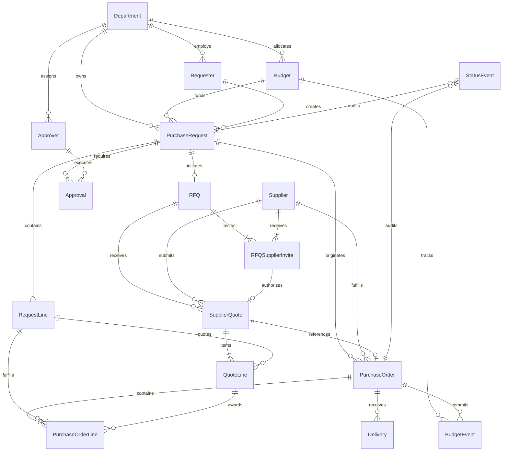

# System Architecture

## 1. Project Purpose & System Boundaries

The **Procure-to-Pay Synthetic Data Generator** (`procure-to-pay-datagen`) is an enterprise-grade synthetic data engineering platform designed to simulate a realistic, end-to-end corporate procurement lifecycle. The platform generates structurally sound, relational, anomaly-injected datasets for testing, machine learning evaluation, and data pipeline benchmarking.

### In Scope
- Generation of master data: Departments, Budgets, Requesters, Approvers, and Suppliers.
- Generation of transactional procurement records: Purchase Requests, RFQs, Supplier Invites, Quotations, Multi-level Approvals, Purchase Orders, and Partial/Full Deliveries.
- Synthetic ledger events: Budget transactions (Allocation, Reservation, Commitment, Release, Spend) and Lifecycle Status transitions.
- Offline, deterministic foreign exchange (FX) conversion engine.
- Relational schema modeling in SQLite with complete foreign keys and constraints.
- Multi-tier validation frameworks (schema integrity, referential consistency, business rule compliance).
- Multi-format exports (relational SQLite, normalized CSV, hierarchical JSON).

### System Boundaries (Explicitly Out of Scope)
- Frontend user interfaces, web dashboards, or REST APIs.
- External live API integrations (e.g. live FX rate fetching).
- Production payment gateways, invoice OCR processing, or actual bank settlement.
- Distributed workflow engines (e.g. Airflow, Celery) or container orchestration at this phase.

---

## 2. Python Package Structure (src-layout)

The repository implements the standard Python `src`-layout to ensure package isolation and clean installation boundaries:

```
procure-to-pay-datagen/
├── .gitignore
├── pyproject.toml              # Packaging, build configuration & metadata
├── requirements.txt            # Pinned dependencies
├── README.md                   # Project overview & operator documentation
├── config/
│   └── default.yaml            # Centralized system & scale configuration
├── src/
│   ├── datagen/                # Core generator package
│   │   ├── __init__.py         # Package marker & version
│   │   ├── __main__.py         # Module execution entry point
│   │   ├── cli.py              # CLI argument parser (argparse)
│   │   ├── config.py           # Strict YAML config parser & validator
│   │   ├── ids.py              # Centralized deterministic IDFactory
│   │   └── fx.py               # Deterministic Decimal FX engine
│   └── validate/               # Quality assurance & verification package
│       ├── __init__.py
│       ├── __main__.py
│       └── checks.py           # Foundational schema & relational validators
├── data/
│   ├── csv/                    # Target directory for CSV exports (.gitkeep)
│   ├── json/                   # Target directory for JSON exports (.gitkeep)
│   └── sql/
│       ├── schema.sql          # Canonical DDL with strict relational constraints
│       └── seed.sql            # Seed SQL script placeholder
├── docs/                       # Architecture, data dictionary, & technical specifications
│   ├── architecture.md
│   ├── data_dictionary.md
│   ├── assumptions.md
│   ├── validation_summary.md
│   ├── reproducibility.md
│   ├── source_manifest.md
│   └── AI_USAGE.md
├── tests/                      # Automated pytest suite
│   ├── __init__.py
│   ├── test_config.py
│   ├── test_fx.py
│   ├── test_ids.py
│   └── test_schema.py
└── ai/
    └── prompts/
        └── 01_phase1_foundation.md
```

---

## 3. Configuration Flow

Configuration is centralized and immutable at runtime:
1. `config/default.yaml` defines default parameters across 8 sections: `project`, `generation`, `scale`, `approval_thresholds`, `supplier_scoring`, `anomalies`, `procurement`, and `fx_rates`.
2. `datagen.config.load_config()` reads the YAML file, performs strict structural and type validation, and rejects malformed values.
3. Default values are never silently substituted for missing or invalid parameters. Any violation raises `ConfigValidationError`.
4. Downstream components receive the validated dictionary or pass configuration parameters explicitly without relying on global mutable state.

---

## 4. Centralized ID Generation Architecture

Every entity identifier in the system is managed by `datagen.ids.IDFactory`:
- **State Isolation**: IDFactory maintains independent instance counters per entity, avoiding global counters or random UUIDs.
- **Deterministic Numbering**: IDs are zero-padded monotonic sequences (e.g. `DEPT-01`, `BUD-0001`, `PR-2026-000001`).
- **Fiscal Year Scoping**: Core procurement transaction IDs (`PR`, `RFQ`, `QUO`, `PO`, `DEL`) embed the configured fiscal year (default: 2026).
- **Hierarchical Delivery IDs**: Deliveries derive directly from their parent Purchase Order ID with an incremental two-digit sequence (e.g. `DEL-PO-2026-000001-01`).
- **Collision Prevention**: The factory tracks all generated IDs and guarantees zero collisions.
- **Regex Validation**: Standard canonical regex patterns (`ID_REGEX_MAP`) are exported for cross-module validation.

---

## 5. Fixed FX Conversion Architecture

All monetary conversions are deterministic and offline:
- **Base Currency**: US Dollar (`USD`).
- **Source Rates**: Static exchange rates defined in configuration (USD, EUR, GBP, INR, JPY).
- **Precision Guarantee**: Calculations utilize Python `decimal.Decimal` with explicit `ROUND_HALF_UP` quantizing to two decimal places (`Decimal("0.01")`).
- **Database Storage**: Financial values in SQLite are stored as `INTEGER` minor units (cents / pence / paise / yen) to prevent floating-point drift.

$$\text{USD Amount} = \text{Amount}_{\text{source}} \times \text{Rate}_{\text{source}}$$
$$\text{Target Amount} = \frac{\text{USD Amount}}{\text{Rate}_{\text{target}}}$$

---

## 6. Entity-Relationship Model



---

## 7. Future Generation Pipeline (Phase 2 - Phase 7 Roadmap)

The generator executes in structured, phased pipelines:
1. **Phase 2 (Master Data)**: Seed organizational hierarchy (Departments, Budgets, Requesters, Approvers, Suppliers).
2. **Phase 3 (Requisition & Sourcing)**: Purchase Requests, Request Lines, RFQ issuance, Supplier Inviting, and Multi-currency Quotations.
3. **Phase 4 (Approval & Purchasing)**: Scoring engine, multi-level approvals, PO creation, and budget commitments.
4. **Phase 5 (Delivery & Lifecycle)**: Partial/full shipments, synthetic expenditure events, and lifecycle status events.
5. **Phase 6 (Anomaly Injection)**: Split POs, budget overruns, phantom suppliers, and late deliveries injected with controlled target anomaly rates.
6. **Phase 7 (Export & Verification)**: Export to normalized CSV and JSON, multi-tier reconciliation check against ground truth artifacts.
